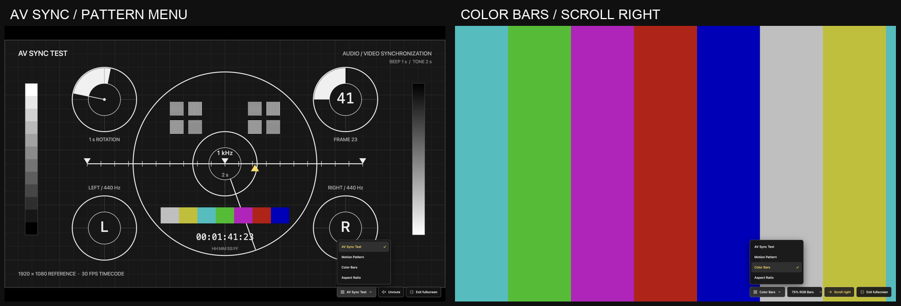
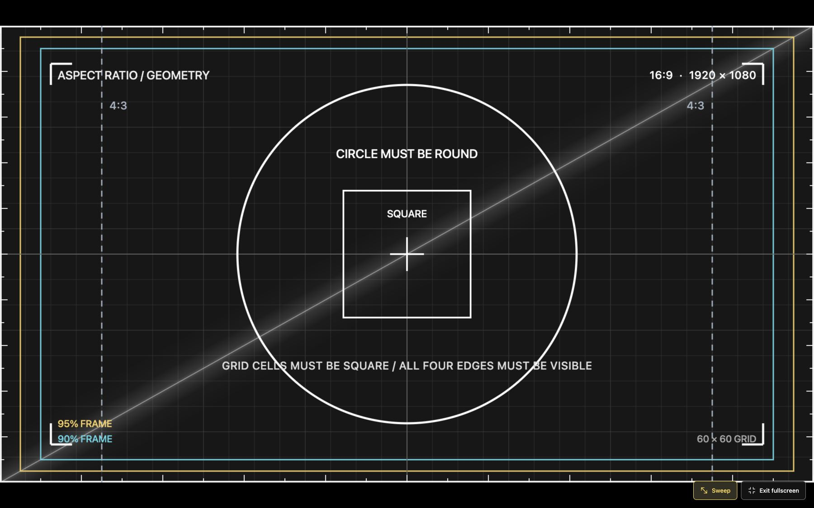

# AV Test Patterns

A standalone browser-based audio/video test suite. No installation, external assets, or build step required.

## Run

Open `index.html` in a current browser, or serve this directory with any static web host. The page starts with **AV Sync Test** and attempts to play audio automatically. If the browser blocks autoplay with sound, click **Unmute** once to enable it. A brief reminder appears only when sound has not started.

Use the bottom-right menu to switch between the four patterns. Controls fade out after five seconds of inactivity and reappear when the mouse moves or the page receives keyboard/touch input.

## Patterns

- **AV Sync Test**: a 440 Hz beep every second; every two seconds, both 440 Hz and 1 kHz play together in both channels; the 440 Hz beeps in between alternate right and left; synchronized flashes; 30 fps timecode; rotating markers; and a constant-speed triangular marker with immediate endpoint reversal.
- **Motion Pattern**: three constant-speed targets moving at 240, 480, and 960 reference pixels per second. Includes Pause / Resume.
- **Color Bars**: 75% or 100% browser RGB code-value bars. **Scroll right** toggles continuous, constant-speed rightward scrolling, completing one cycle every ten seconds.
- **Aspect Ratio**: a 16:9 reference image with a circle, square grid, 4:3 guides, and 90% / 95% frames. **Sweep** toggles a slow diagonal light sweep aligned to the 16:9 diagonal, repeating every fourteen seconds.

The AV, motion, and geometry patterns retain their 1920 x 1080 reference aspect ratio. Color bars fill the display. Switching away from AV Sync silences audio output.

## AV Sync audio routing

| Time | Left channel | Right channel |
| --- | --- | --- |
| 0 s | 440 Hz + 1 kHz | 440 Hz + 1 kHz |
| 1 s | Silent | 440 Hz |
| 2 s | 440 Hz + 1 kHz | 440 Hz + 1 kHz |
| 3 s | 440 Hz | Silent |

The four-second sequence repeats. Both channel rings flash with each stereo pulse; the single-channel flashes follow the alternating 440 Hz beeps.

## Keyboard shortcuts

| Key | Action |
| --- | --- |
| F | Toggle fullscreen |
| M | Mute / unmute in AV Sync |
| Space | Pause / resume in Motion Pattern |
| Escape | Close the pattern menu or leave fullscreen |

## Preview

